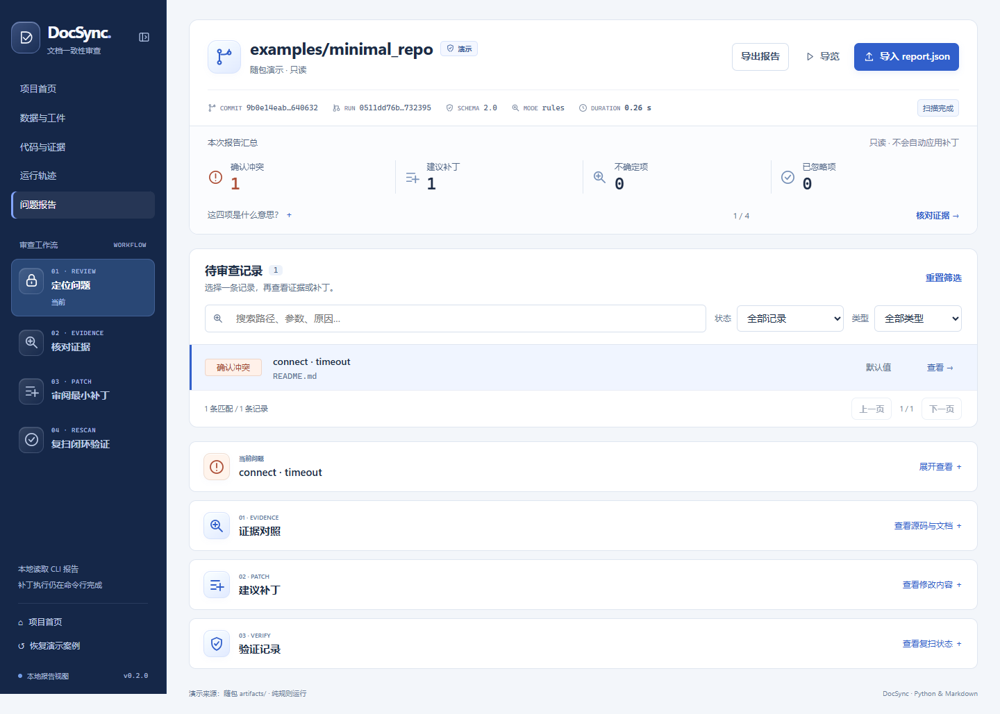

# DocSync 软件优化与使用说明

日期：2026 年 10 月 13 日
适用对象：使用者、队友和项目负责人
范围：当前本地 DocSync-main 工作区

## 这次优化完成了什么

本轮把前端从主要展示固定案例的演示页面，改成能够审阅不同 DocSync 报告的本地工作区，同时补上环境检查、输出保护、安全启动和交接打包。最重要的变化是：导入自己的报告以后，五个页面会使用同一份数据；缺失证据、不确定结论和异常输入都有明确处理，不再借用演示数据填空。

DocSync 当前仍是面向 Python 与 Markdown 的一致性审查工具，不是适用于所有语言、所有自然语言文档的通用分析平台。本轮提升的是实际使用、可靠性与交付能力，没有改写正式测试标签，也没有把开发集成绩包装成泛化结论。

如果你只想立即使用：双击项目内 **DOCsync-demo-video-package/启动前端.cmd**，进入“报告”，导入 report.json。详细操作见 [前端使用与交接](../DOCsync-demo-video-package/给队友-打开与修改.md)。

**补充落地复核：** 已将下表的 13 个改动方向逐一对应到实际实现和回归检查，并修正初版遗漏的模型预检、异常字段校验、复扫缓存恢复、分页选中状态、缺失坐标和不完整复扫提示。详见 [逐项验收与补充修复](optimization-acceptance-20261013.md)。文末“离正式发布还有哪些工作”仍是未完成的后续事项，不包含在“已完成”结论中。

## 已完成的改动

| 方面 | 原先的问题 | 现在的行为 |
| --- | --- | --- |
| 跨页面数据 | 报告页导入后，其他页仍固定使用演示数据 | 首页、数据、证据、运行和报告页共用本次标签页会话 |
| 证据真实性 | 代码页会根据常量拼出固定函数，结论含固定演示值 | 只展示报告实际表达式、引用、路径和行号；缺失内容明确说明 |
| 记录定位 | 多条告警只能从简单下拉框选择 | 搜索路径、参数和原因；按状态、类型筛选；每页 12 条；支持记录链接 |
| 不确定判断 | 只统计部分 judgment，漏掉验证拒绝，可能重复计数 | 按不确定判断与 rejected 的 claim_id 并集计数，并提供可展开记录 |
| 异常报告 | 版本或嵌套字段异常可能导致页面出错 | 结构检查拒绝无效输入，错误反馈明确，已有报告继续保留 |
| 忽略规则 | 过期的忽略原因、日期不完整 | 保留原因和到期日期，说明该告警仍有效 |
| 复扫对照 | 只能看随包修复结果 | 可导入自己的复扫，检查仓库、基准提交、配置、模式与检查范围 |
| 导出 | 缺少完整交接入口 | 下载当前 JSON 和所选补丁 diff；不自动修改仓库 |
| CLI 预检 | 环境或 ZIP 目录问题往往到扫描时才发现 | 新增 doctor，一次检查 Python、依赖、Git 和可选配置、仓库 |
| 输出安全 | patch 可能覆盖已有 diff 或清单 | 拒绝既有输出与同路径冲突，排他创建防止检查后的竞争覆盖 |
| 本地启动 | 用户需要手工寻找 HTML 或启动整个目录服务 | 双击启动，只公开前端白名单，不开放私人资料目录 |
| 交接发布 | 直接压整个目录可能夹带缓存、私有标注或环境 | 按明确文件清单生成独立前端 ZIP，保留启动层次和许可证 |
| 工程维护 | 前端缺少共享数据契约测试，部分脚本类型检查失败 | 增加数据层、浏览器、预检、服务器与打包测试，修正类型及格式问题 |

### 前端视觉和信息结构

保留蓝色主色、深蓝导航和轻磨砂图标。磨砂仅用于小面积功能图标，不把整页做成玻璃背景。正文使用本地系统无衬线字体；源码、哈希和 diff 使用等宽字体，不下载远程字体。

首页保留项目说明、架构和查看入口。报告页采用“摘要 → 可筛选记录 → 按需展开详情”的顺序，缩小重复标题和空白区。图标大小、按钮层级、选中状态和键盘焦点统一；手机端导航换行，代码区允许内部滚动，不撑破页面。

图 1 为真实浏览器截图，展示随包演示报告。页面数字来自已有归档工件，不是产品普遍效果。

### 数据契约与真实结论

report-store.js 统一处理 Schema 1.0/2.0、报告结构、记录生成、计数、会话存储和对比条件。app.js 与 portal.js 都依赖这个数据层，减少各页分别推断结论造成的偏差。

确认冲突仅包含 INCONSISTENT、VERIFIED 且未忽略的 Finding。不确定项包含无法确认的判断和验证拒绝；缺失必要记录时显示未知，不补成零。PARTIAL、FAILED 和未验证状态都有独立提示。

导入校验只确认“这个文件的结构可以读取”，不会重跑 Python 验证器，更不会证明输入文件没有被伪造。前端采用文本节点展示外来内容，测试中含 HTML 的输入不会成为可执行页面内容。

### 复扫对照的边界

两份报告只有在仓库标识、基准提交、扫描配置、分析模式和检查类型一致，且运行 ID 不同时才可直接对比。正常的 commit 首扫到 working-tree 复扫允许比较；不同基准提交暂不自动推断修复关系。

展示“1 → 0”只说明报告中的确认冲突数变化，不证明网页执行过修复，也不证明未覆盖声明正确。补丁是否确实执行，应结合 CLI 的 apply 输出、前像检查和新报告一起核对。

### 安全启动与隐私

serve_frontend.py 使用标准库，仅监听 127.0.0.1。资源白名单限定在前端页面与静态资产，拒绝目录浏览、父路径、符号链接和 junction 跳转；不提供 POST 上传或文件修改入口。响应包含限制连接的 CSP 等浏览器安全头。

导入文件由浏览器本地读取，使用 sessionStorage 在同一标签页导航间共享。缓存不是长期存储，容量受浏览器限制；存储失败会明确提示。恢复演示只清理本应用的缓存，不删除磁盘报告，也不清除其他应用的数据。

本地服务器用于个人审查和演示，未提供账户、鉴权或互联网部署能力，不应直接暴露到公网。

## 怎么使用新版

### 先检查环境

在已安装 DocSync 的 Python 3.12 环境运行：

~~~text
docsync doctor
docsync doctor --repo 你的Git仓库根目录
docsync doctor --repo 你的Git仓库根目录 --config docsync.toml --format json
~~~

doctor 不联网、不调用模型、不执行扫描；没有显式 --repo 时不会检查当前目录，没有 --config 时不会自动载入本地配置。错误返回 2，只有警告返回 0；预检成功不等于模型端点或扫描已经成功。

当前 DocSync-main 是下载目录，没有 .git 历史。它可以启动前端，但不能直接当作固定提交扫描目标。审查自己的项目时应使用实际 Git clone；不要为了绕过提示随意伪造提交历史。

### 审查一份真实报告

1. 双击启动前端.cmd，或在项目根目录运行 python scripts/serve_frontend.py。
2. 点击“报告 → 导入 report.json”，选择 DocSync 的扫描结果，单文件不超过 10 MB。
3. 用搜索或筛选找到记录。点选后按需展开当前问题、证据、补丁与验证信息。
4. 补丁需人工审阅。在 CLI 用原始 manifest 应用，而不是在网页中自动执行。
5. 用 --working-tree 对未提交的修复复扫。把新报告导入“验证记录”，核对计数和扫描状态。
6. 要保留当前报告，下载 JSON。重启服务可能换端口，关闭标签页后也不应依赖会话缓存保存数据。

### 发给队友

主项目可执行：

~~~text
python scripts/package_frontend.py --out DocSync-frontend-handoff.zip
~~~

脚本按白名单打包，不递归收集整个工作区；如果目标 ZIP 已存在会拒绝覆盖。交接包包含页面、内嵌报告、归档演示工件、启动器、使用说明和 LICENSE，保留 DocSync-frontend 根目录。

队友完整解压后双击其中的启动前端.cmd。日常使用不需要 Node/npm 或模型密钥。执行扫描仍需另取核心项目并安装 Python 3.12 依赖；前端包不是核心引擎安装包。

初版交接包为工作区 `交付/DocSync-前端交接包-20261013.zip`，补充修复后的新版为 `交付/DocSync-前端交接包-20261013-复核版.zip`。请优先使用复核版，不要把两个版本解压覆盖混用。它不包含个人标注、接触声明或整个核心仓库。核心源码分发包 sdist 是另外的本机构建检查产物，沿用仓库现有规则包含历史标注与审计归档；本轮没有重新确认这些归档的对外分发授权，因此不要把它当作已审查完成的公开发布包。原始归档未删除或修改。

## 首轮验证（补充修复前）

以下保留首轮实测结果；补充修复后的最新结果见 [逐项验收记录](optimization-acceptance-20261013.md)，不要把首轮数量当作最新测试数量。

测试在 Windows 本机进行。Python 使用 3.12 和项目固定依赖 pydantic 2.11.7、markdown-it-py 3.0.0，设置 PYTHONUTF8=1，并显式指向当前 src，避免使用旧工作区的 editable 安装。

| 验证项目 | 结果和含义 |
| --- | --- |
| Python 全量回归 | 最终 279 passed、3 skipped，117.63 秒；包括新增的交接打包测试 |
| 前端数据契约 | Node 原生测试 19 项通过 |
| 浏览器交互 | 真实 Chromium 148，21 组检查全部通过 |
| 实际启动器 | 在真实 Python 本机服务下再次通过浏览器检查，导入和下载未被 CSP 阻断 |
| 布局 | 五页检查 320、390、768、1024、1440 像素，无页面横向溢出；桌面与手机截图已查看 |
| 浏览器异常 | 检查过程中未捕获异常、CSP 违规、外部请求均为 0 |
| CLI 全流程 | 新建受控演示仓库 → doctor → rules 首扫 → patch → apply → 工作树复扫 |
| 首扫与复扫 | COMPLETED，确认冲突 1 → 0，不确定项 0 → 0，模型请求均为 0 |
| 补丁安全 | 只修改 README 目标声明，源码哈希不变；重复应用返回 STALE_PATCH 且 README 不再变更 |
| 静态检查 | Ruff 检查通过，64 个文件格式通过；mypy 检查 src 和 scripts 共 27 个源文件通过 |
| 构建 | wheel 和 sdist 离线构建成功，不安装新依赖 |

3 个跳过均与当前 Windows 进程没有创建真实符号链接的权限有关。跳过不算通过；启动器另有不需要系统权限的链接守卫测试。部署前仍应在具备权限的环境与 Linux CI 执行这些分支。

CLI 本轮运行标识：首扫 8fce7dc50ffb4c11afa8db3b2f5542d7，复扫 992f72a70c844973b1502b0a6a30b355。完整检查摘要和证据索引见 [本轮验证记录](audit-samples/product-maturity-20261013/README.md)。

**旧演示与新验证分开。** 包内 artifacts 和 demo-data.js 保留原始历史工件，版本以其 manifest 为准；没有把本轮检查结果写回旧文件，也没有伪造最新运行时间。上面的 1 → 0 是受控功能验证，不是独立正式准确率实验。

## 与竞赛要求的对应

本节依据队伍提供的《附件1 AIC AI开源竞赛规则及作品提交要求0812》本地 PDF，第 2、4、5 页。规则强调可运行成果、可验证效果、真实贡献和资源披露，不要求商业产品成熟度，也不以页面、代码行或材料数量作为评分依据。

| 评分方向 | 本轮可提供的证据 | 仍需团队完成 |
| --- | --- | --- |
| 问题与场景价值 15 分 | 从导入、定位、审阅到复扫的真实使用流程 | 真实用户试用与需求反馈，不能由 AI 编造 |
| 创新与方案设计 20 分 | 共享报告契约、保守不确定处理、受校验约束的审查流程 | 清楚区分核心算法既有贡献与本轮产品改进 |
| AI 与开源融合 20 分 | 保留既有可选模型适配器、独立验证与开源结构 | 展示 AI 在产品中的实际作用、规则与模型对比；本轮零模型请求不等于完成 AI 效果验证 |
| 完成度与可验证效果 25 分 | 测试、真实浏览器记录、CLI 修复复扫与安全保护 | 独立正式测试和第三方复验，不能拿开发集代替 |
| 开放成果与复用价值 15 分 | 启动器、使用说明、测试脚本、白名单交接包和许可证 | 审核后提交主仓库、验证远程 CI、准备可访问成果链接 |
| 材料规范与表达 5 分 | 改动说明、使用手册和可复现路径 | 最终材料脱敏、资源清单与授权确认 |

建议录制 3 至 5 分钟 MP4：用约 30 秒说明文档漂移问题，展示导入自己的报告、定位一条冲突、核对原文和最小 diff，再展示 CLI 显式应用及真实复扫；最后说明不确定情况和开放成果。视频不要只播放网页动画。

技术报告建议控制在 15 页以内，提交 PDF 不超过 10 MB；演示视频不超过 300 MB。评审材料不得出现学校名称、学校 LOGO 或指导教师信息。团队必须如实披露 AI 工具参与环节、审核与验证工作。本轮修改由 Codex 辅助实现和检查，团队最终审核尚不能由这些自动检查替代。

## 离正式发布还有哪些工作

以下是后续事项，不属于本轮已实现能力：

1. **独立正式评测。** 按现有项目任务完成真实外部样本资格审查、标注与裁决；冻结后再评测，禁止用已接触样本的开发成绩宣称泛化效果。
2. **团队试用。** 让至少几位实际使用者独立完成“导入 → 找到问题 → 解释证据 → 导出”的任务，记录失败环节、用时和原始反馈，再决定是否继续调整界面。
3. **发布与跨平台。** 在干净分支接收本轮代码，运行远程 Ubuntu/Windows CI，补齐当前跳过的系统权限分支；审查源码包中历史标注与审计归档的分发范围，确认包和源码版本一致后再打 tag。部分重建工具与测试依赖这些归档，不能直接删除目录后仍声称完整可复现。
4. **安全扫描后端。** 如果希望网页直接选择项目并扫描，需要另外设计受限本地 API、仓库访问范围、任务取消、日志、写入审批和前像校验。当前版本没有此服务。
5. **更广支持。** 更多语言、框架和复杂自然语言需要明确支持契约、拒答条件与独立回归集，不能仅新增界面选项。
6. **持久化与协作。** 长期运行历史、多人账户、权限和云同步需要新的存储与安全设计，不能把 sessionStorage 当数据库。

本轮没有推送 GitHub，也未创建远程发布。现有源目录缺少 Git 元数据，不能准确声称这些更改已属于某个远程 main 提交。请由队长审阅改动、选择承接分支并完成仓库合并。

## 主要文件

| 文件 | 改动目的 |
| --- | --- |
| src/docsync/doctor.py 与 cli.py | 环境自检、命令注册、补丁导出防覆盖 |
| scripts/serve_frontend.py | 限定资源范围的本地只读启动器 |
| scripts/package_frontend.py | 白名单前端交接打包 |
| pyproject.toml | 源码分发包显式纳入启动器需要的前端资源与测试，wheel 仍只提供核心引擎 |
| scripts/lock_dependencies.py | 修正类型变量复用，不改变锁定行为 |
| src/docsync/extractors/python_ast.py | 仅格式整理，没有扩张算法支持范围 |
| demo-ui/report-store.js | 报告验证、统计、记录、缓存和可比性契约 |
| demo-ui/app.js 与 styles.css | 报告审查工作台和响应式样式 |
| demo-ui/portal.js 与 portal.css | 首页及数据、证据、运行页的真实数据绑定 |
| demo-ui 五个 HTML | 多页面结构、操作入口和渐进展开 |
| tests/unit/test_doctor.py | 预检与安全导出回归 |
| tests/unit/test_frontend_server.py | 服务器请求与访问范围回归 |
| tests/unit/test_frontend_package.py | 打包清单、排除私人文件和防覆盖回归 |
| demo-ui/tests/report-store.test.cjs | 数据结构与统计契约测试 |
| scripts/qa_frontend.cjs | 可复跑的真实浏览器检查 |
| .github/workflows/ci.yml | 纳入前端契约测试、脚本类型检查和 UTF-8 测试环境 |

表中的 demo-ui 路径位于 DOCsync-demo-video-package 目录。原始标注、接触声明、正式冻结集及其人工复核记录不属于本轮修改范围。
